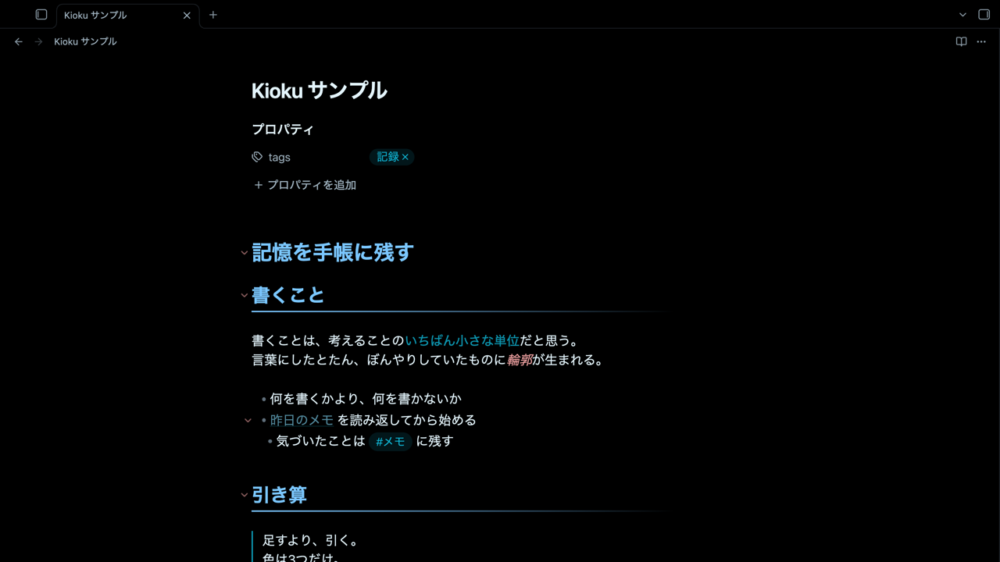

# Kioku

黒地に、色は3つだけ。
書くことに目を向けるための、静かなダークテーマです。



## 考え方

足すより、引く。
画面にある色を減らし、どれも淡く落ち着かせています。
差し色の淡いオレンジは「いまの位置」を示す2か所だけに使っています。

| 役割 | 色 |
| --- | --- |
| 表題・本文 | 白に少しだけ水色 |
| 見出し・リンク・タグ | 淡い青〜シアン |
| 斜体・折りたたみの三角 | 薄い赤 |
| 差し色（カーソル／開いているノート） | 淡いオレンジ |

- 本文はひと回り細い字（ヒラギノ角ゴ W3）で、長く読んでも疲れにくくしています。
- 見出し2には、左から右へ消えていく細い線を引いています。
- Obsidian 標準テーマの変数を上書きしているだけなので、プラグインとの相性を崩しにくい作りです。

## 対応

- ダークモード専用です。ライトモードでは Obsidian 標準の見た目になります。
- 日本語の文章を書く人に向けて調整しています（macOS のヒラギノ角ゴで確認）。

## 色を変えたいとき

`theme.css` 冒頭の「色の定義」にある `--kioku-*` の値だけを書き換えれば、全体の色が変わります。
CSS スニペットで同じ変数を上書きしても構いません。

```css
.theme-dark {
  --kioku-heading: #7ac6ff; /* 見出し */
}
```

---

## English

**Kioku** is a quiet dark theme for Obsidian: a black background and only three colors — icy white for text, soft blue for headings and links, and pale rose for italics and fold arrows. A single apricot accent marks the cursor and the active note. Body text uses a lighter weight, tuned for writing in Japanese.

Dark mode only. To customize, edit the `--kioku-*` variables at the top of `theme.css`, or override them in a CSS snippet.

## License

MIT © Kioku Labo
